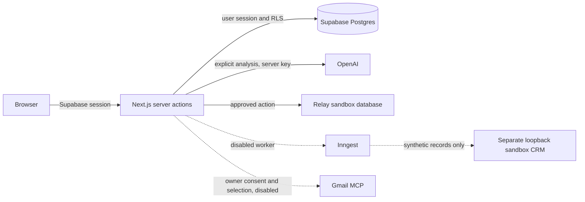

# Relay architecture and release runbook

Relay is incomplete and is not approved for real customer data. This document records the current implementation and remaining release work.

## Data flow and boundaries

Customer messages, documents, model output and tool responses are untrusted text. Database functions enforce role and action-state checks; RLS restricts authenticated reads. AI output is schema-checked and quotes must match the input, but citation membership does not establish that a generated statement is supported. A human must review the evidence. Approval of a CRM change applies to its exact before/after state; knowledge changes invalidate older action approvals. Draft approval applies to the saved text and is displayed as out of date if knowledge changes. Nothing sends email.

The separate synthetic CRM is a local test service. The Inngest path, Gmail OAuth and Gmail import remain disabled; do not interpret flags or code presence as a working hosted connection. Gmail's read-only OAuth scope can cover the entire mailbox even though Relay requires explicit selection for each import.

## Local verification

1. Install Node.js 22.13 or later and run `npm ci` in the project directory.
2. Run `npm run lint`, `npm test`, `npm run test:db`, and `npm run build`.
3. Install a Playwright Chromium browser with `npx playwright install chromium`; then run `npm run test:e2e:mock`. This uses a synthetic local backend, not a real Supabase instance.
4. Run `npm audit --omit=dev --audit-level=high`. The current install reports moderate advisories and no high findings, using an Inngest-scoped Zod override outside its declared range. A local Dev Server synthetic execution and duplicate-event check passed; keep durable jobs disabled until hosted compatibility and recovery are verified.
5. `npm run eval:baseline` evaluates the deterministic keyword baseline; it is not an AI quality or customer-outcome measurement. The paid live evaluation is separately guarded and should use only synthetic fixtures.

## Hosted setup and recovery

- Use a disposable Supabase project to test all migrations and authorization checks before changing a hosted project. Migration 001 was applied manually to the existing project; inspect the actual schema and migration history before using a migration tool. Do not blindly replay migration 001 or mark migration history as applied without verifying the schema.
- Back up and verify recovery procedures before applying any migration to an existing project. Apply reviewed pending migrations in order, then test sign-in, role boundaries, cross-organization access, knowledge replacement, action approval and retry on disposable records. Local PGlite success does not prove hosted Supabase behavior.
- Keep `.env.local` and service-role, OAuth, encryption, worker and model keys server-side and out of source control. Revoke and replace credentials exposed in chat. Configure deployment secrets through the hosting provider, not in repository files.
- Enable only the features whose service configuration, security review and end-to-end tests have passed. In particular, Gmail import also requires a verified retention worker; environment flags are assertions, not proof of retention.
- For an uncertain external CRM dispatch, inspect the action and reconcile by its action ID. Do not blindly resend a write that may already have succeeded. Workspace deletion is intentionally blocked when external sandbox dispatch records exist because coordinated cleanup is not implemented.
- A deployment rollback can restore a previous application version, but it does not automatically undo database changes or external writes. Restore data only from a verified backup with a separately reviewed recovery plan.

## Remaining release gates

Review the provisional dependency override and remaining advisories, validate migrations and RLS in hosted Supabase, connect and test live OpenAI with bounded quota, verify durable job failure and recovery on the hosted worker, complete a real browser end-to-end run, and review the security and retention controls. Gmail additionally requires Google's access prerequisites, privacy review and a test identity. Public hosting and a recorded walkthrough remain outstanding.
